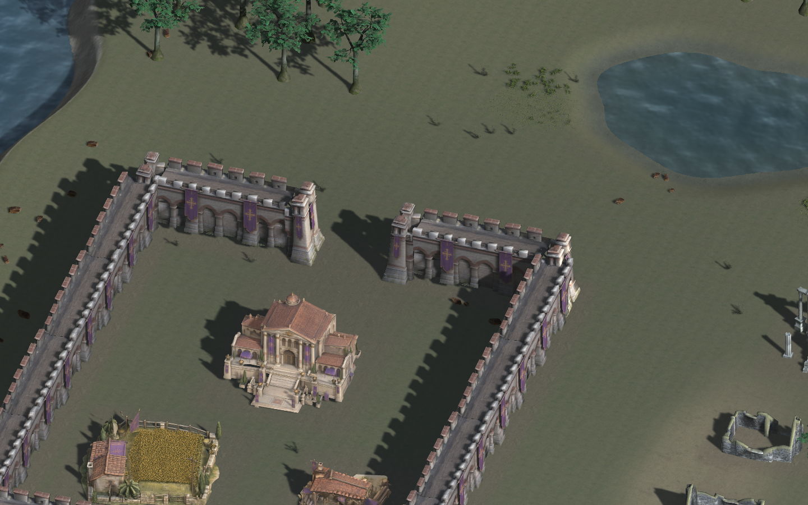
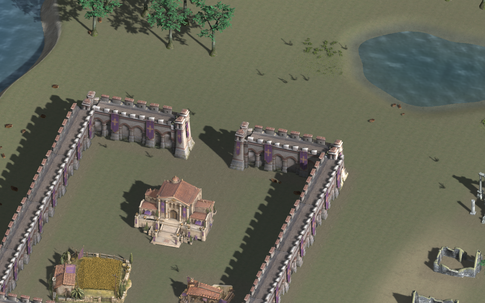
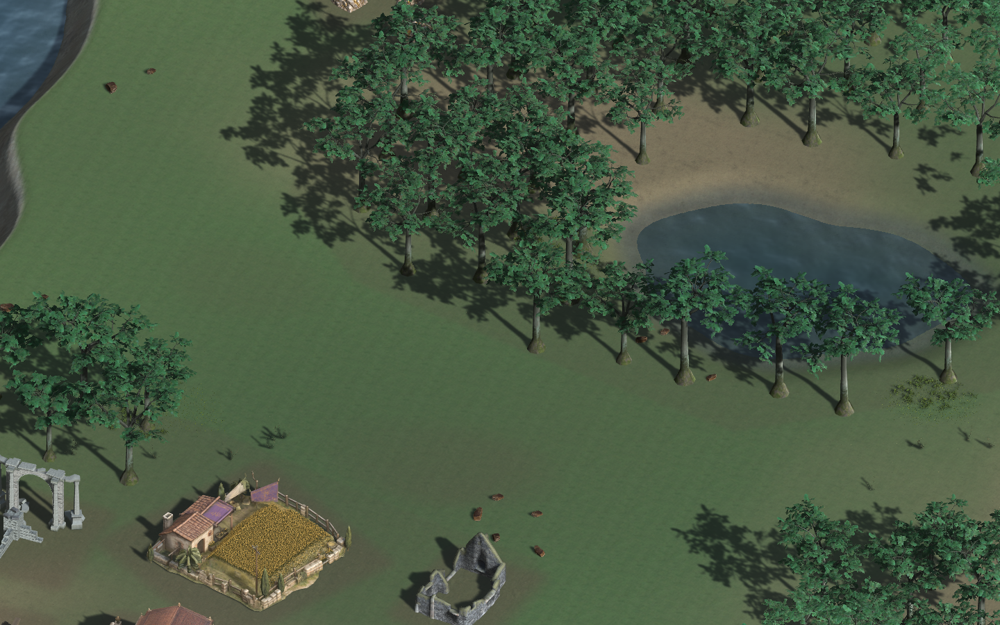
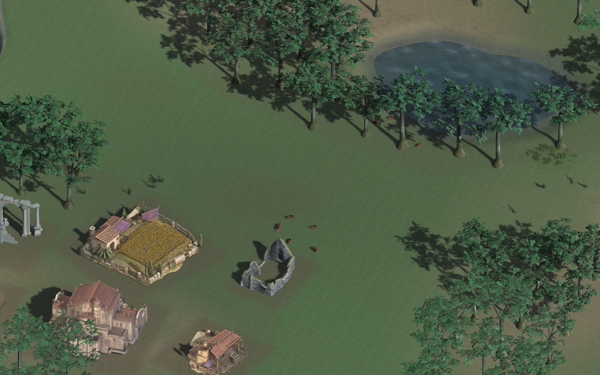
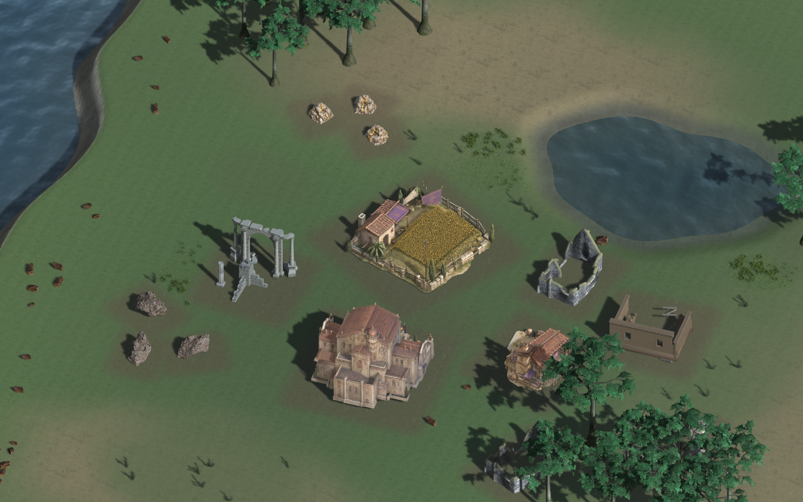

# Vision 1 地图制作和打开说明

## 当前农田修订：青黄满铺麦田＋右上角小屋（2026-10-16）

沿用同一 `EnvironmentDenseVision.unity`、Vision-6 打开菜单和预览程序，没有新建控制器或改地图布局。小麦改为明显麦黄的穗／成熟叶和少量青绿细茎；小屋仅刚性平移至地块右上角（世界+x/+z），屋檐离两边0.35m。取消屋周矩形裸土区，麦株完整铺到墙脚，屋前深色是保留的屋檐阴影而非地块空框。14×14m参考格／14m中心距不变，12块田及81树／30建筑／9矿的布局和中性白日光不变。

正式源仍在 `art/Blender主文件/ZombieGame.blend`，新集合 `农田整格 · 青黄满铺麦田＋右上小屋`、评审集合 `青黄麦田右上屋 · 2×2评审`。本次主文件SHA `69704fa392d17bcc253d669699b0001031c91884cf8fdc544d582e00d3e55d2d`；独立导出 `art/models/grid-footprints/Pasture14_GoldenCorner/Pasture14_GoldenCorner.fbx`，SHA `3ee3c15e36456b3a199321ec22bd597dd85d2f0940dac15981354e1548996a8e`。旧464对象、旧农田导出／Unity Prefab／截图都保留，实时未保存Zombie文件未碰。19,600点麦根覆盖、无院落裁空、房屋网格／UV／材质／旋转比例保护、地块边界和FBX回读检查通过；[源检查](vision-golden-corner-source-validation.json)。

实际Unity同白光截图：[四块俯视](../../art/environment/inspection/vision-dense-v6/golden-corner-v1/farm-four-tiles-top.png) · [斜上方近景](../../art/environment/inspection/vision-dense-v6/golden-corner-v1/farm-isometric.png) · [整体地图](../../art/environment/inspection/vision-dense-v6/golden-corner-v1/composition.png)。8个麦色材质与源RGBA上传误差0，独立播放器39件源／地块贴地／建筑重叠／入口净空／森林检查通过。原野草整体贡献0.00003093仍低于原0.0003门槛，总报告仍FAIL，不当作整个环境通过或游戏战斗验收；[本轮检查摘要](vision-golden-corner-validation.json)。

## 保留：Vision 6 首次密集布景与连片麦田（2026-10-16）

用户追加授权现有模型重复满铺，并要求农田去掉院圈，连成大片。这版使用同一个 EnvironmentShowcase 系统，保留旧版，不改正式地图／单位数值／建造平衡／渲染管线。

- 场景：`Assets/_Tests/EnvironmentShowcase/Scenes/EnvironmentDenseVision.unity`。
- 菜单：`Zombie Game → Environment Showcase → Vision-6 → Open dense repetition and Play`。
- 本机预览：`Builds/EnvironmentDenseVision.app`；生成方法 `VisionDenseTools.prepare_and_build_dense_preview()`。
- 实际布局：30栋建筑（其中12块牧场）、9处矿石、81棵原生Oak；北沿连续Terrain悬崖和两侧收口，林带、L形田带、墙内田块及墙东建筑街区。仍有海和封闭池塘。池／田净空调整前的91树是中间结果，不当作最终实数。
- 活动地面仍为4.2m；边界悬崖是明确的非活动区域。延续v5明亮中性白光、六层PBR与Road零，不用压暗曝光制造冷感。

牧场源已在正式 `art/Blender主文件/ZombieGame.blend` 的 `农田整格 · 仅小屋与连续麦田` 集合修改：移除外围栅栏、旗杆、竖布、树、院落与田埂；保留原小屋／屋顶和原麦株。麦子铺到方形边缘，逐株刚性落地，没有在Unity变形或补外观。`清爽连片麦田 · 2×2评审` 集合可查看四块28×28m拼接。原414对象及先前442对象均保存，实时未保存的Zombie文件未触碰。

本美术样场采用1m参考格：牧场14×14、基地12×12、工坊8×8m；这不是对正式主基地暂定5×5或正式建造表的改写。后续正式接入须显式确认格距／占地，不逐轴压缩建筑。源FBX已包含整体等比尺寸，Unity根scale为1，以真实地表锚点0加0.025m贴地，不以埋地下的包围盒底抬高地块。相邻牧场中心距恰为14m，没有额外留白。树与矿物保留自然轮廓。

源交接：`art/grid_footprint_handoff.json`，主文件SHA `468a608185ce139913f1b79e04f5e20d0a7b5662e248d32b6ab28900c096e866`，牧场FBX SHA `f8de881951e71590506ce42fcbddc5b8dfaed368b3cafd49db174d2753d0d895`。重开保护／FBX往返／边界检查见 `vision-grid-source-validation.json`；地表几何缝0、UV相位0，麦株对边截面差≤0.000027m。旧城墙FBX不变，导入器只在完整源版本链、原414件保护证明及当前登记SHA全部吻合时接受新增变体后的主文件。

土壤沿用已许可的[Poly Haven Dirt](https://polyhaven.com/a/dirt)（Charlotte Baglioni，CC0，真实1K颜色／GL法线／粗糙度）；不复制参考游戏素材。真人麦田空间参考仅用于“连续作物、小屋局部空地”的构图，未下载其图片作贴图：[连片麦田航拍参考](https://www.domainedelamiraclette.com/presentation/galerie.html)。原树与中立建筑的归属和许可仍见既有环境manifest。

实际Unity截图：[地图布景](../../art/environment/inspection/vision-dense-v6/composition.png) · [四块农田俯视](../../art/environment/inspection/vision-dense-v6/farm-four-tiles-top.png)。这是独立美术预览，不声称已接经济、NavMesh或万人战斗，也不以技术检查代替用户美术认可。

最终1440×900独立播放器检查：39件源的比例／材质／贴地／像素贡献全部通过，建筑重叠0；入口105个采样阻挡0，巡行检查点最小半宽约1m。10,176个活动地面采样最大高度误差0.000219m；81树、2192m²林带核心及2/2自然空地连接通过。六层／Road零、海池、阴影均通过。首轮失败记录保留：原北排房屋压田、田带侵入入口和池岸，已仅移动整体模型与独立v6水池修正，没有放宽通过阈值。精英兵等正式玩法未动。

野外小草整幅贡献0.00003095仍低于原0.0003门槛，因此总检查仍FAIL；不把已通过的麦田原网格可见性替代野草地丰满程度。环境60fps限帧下两组中景p95约16.67／17.30ms，仅作本机环境记录，不推断万人战斗。共享数值57条、概念文档25项及同一新播放器的旧flat预设回归通过（没有声称重跑全部旧模式）。最终Editor帧865→869（126ms）、当前编译／Console错误0。详见 [v6检查摘要](vision-dense-v6-validation.json)，包含原失败报告、源保护、实际截图SHA及未通过项。新预览等待用户美术评审，不覆盖正式战场。

## 当前对照入口：平地／明亮中性白光 v5（2026-10-15，未美术验收）

用户在查看围城实验后确认原 Blender 墙体已有歪斜，要求活动地面同一水平、冷色不靠压暗灯，改用一张《亿万僵尸》实际截图做固定参照，方向为写实和卡通之间的风格化写实。本轮没有改变源模型、单位数值或正式战场，也没有迁移渲染管线。

当前入口：`Assets/_Tests/EnvironmentShowcase/Scenes/EnvironmentNeutralVision.unity`；菜单 `Zombie Game → Environment Showcase → Vision-5 → Open saved flat neutral comparison and Play`。本机独立播放器为 `Builds/EnvironmentNeutralVision.app`；重新取仓库后用 `VisionNeutralTools.prepare_and_build_neutral_preview()` 重建。旧 v3 入口、92 树布局与 v4 围城实验均保留，不覆盖。

固定参考来自 [They Are Billions 实际防线截图／发行商展示页](https://limitedrungames.com/products/limited-run-534-they-are-billions-ps4)，[原展示图](https://cld.accentuate.io/7222747955253/1692129097750/They-Are-Billions-Screenshot-4.jpg?options=w_1920&v=1692129097750)。已实际查看其连续针叶林边界、平坦聚落、清楚轮廓和林下草土过渡；只参考构图和视觉关系，不复制其模型、纹理或游戏素材到仓库。参考本身带暖日光，本样改为用户指定的偏白中性日光，不能称像素级还原。

- v5 移除了 v4 的两个内陆陡崖高度域，活动陆地目标 4.2m；11,375 个干陆采样最大高度误差 0.000219m，cliff mask 数量 0。另有 5,266 个水体／岸带采样，海池底及不活动的水岸收口不冒称同一行走平面；岸边 Terrain 法线邻域最大斜率仍记录为 0.534°。
- 真正同镜头、同模型的灯光对照：太阳强度 0.95→1.08、颜色 `(0.95,0.97,1)`→`(0.98,0.99,1)`；三色环境补光的 sky 从 `(0.30,0.34,0.38)` 提到 `(0.45,0.48,0.50)`，equator／ground 也明确提高，阴影类型和太阳方向不变。全图平均编码亮度 0.348→0.408，约增加17.2%；近白像素由0.00147%→0.04336%，不是全部变白或蓝色滤镜。对照后灯光状态恢复通过。
- 实际46树、5/5自然开口连通、原生LOD／源装配／材质／贴地检查通过；不是恢复了v3的92树，也不代表达到参考图的密冠针叶林。
- 城内仅主基地／工坊／牧场三个已存在的功能源作为构图小样。原残屋全部列为城外中立废墟，不作为民居凑数；不再重复新增两栋残屋。`composition_only=true`、`complete_city_claimed=false`。缺完整民居、独立兵营／仓库与门扇，不能称已完成可运营城市。
- 1440×900真实播放器中，平地、白光对照、森林、源比例和构图净空检查通过。草总贡献0.00001026仍未达原0.0003门槛，总报告继续FAIL、美术未验收；不降低旧草／森林阈值。单植物源可见检查通过也不替代整幅地表丰满程度。
- 用同一新播放器回归原flat配置和原cliffs欧洲配置均PASS；未声称此次重跑全部五模式四区域。共享数值57条、概念文档27项PASS；`Assets/_Game`、`balance`、`Packages`、`ProjectSettings`无修改。
- 最终Editor已打开v5并实际播放，帧号2892→2898（115ms），活动摄像机正常。Console无编译或运行错误，存在23条旧API／序列化警告，未扩大到无关模块清理。之前安全模式为新增检查脚本未被纳入编译清单，已通过AssetDatabase重新识别和成功编译解决；不需用户删除模型或新建摄像机。不要在Play中继续写C#导致热重载丢失非序列化的环境实例。

证据：`Builds/ArtReview/EnvironmentShowcase/vision-neutral-flat-v5/`；摘要 `docs/dev/vision-neutral-v5-validation.json`。`light-before.png`／`light-after.png`为同镜头真实播放器原PNG；`full-map.png`为实际全图，不隐藏空地。`forest-city-slice.png`为额外Editor相机小样（焦点62,73m，pitch38/yaw−18，ortho20），不能用局部取景声称整个地图已经丰满。

**本轮停止条件：**实看中景和全图后仍明显空，且与参考形态不符。现有疏阔叶Oak不能替代连续密冠针叶林；缺俯视有体积的草丛、完整同风格民居、后沿岩体，墙原网格和贴图也不够规整。继续改亮度、提高面数或重复残屋无法解决这些源缺项。本版保留作诊断对照，下一步应先补合适源，在小片场景验收后再铺全图；不继续无限重排或把技术PASS叫美术完成。

模型清晰度只读核查见 `docs/dev/vision-model-clarity-audit.json`：主基地6889、工坊6438三角，牧场反而268203三角；均绑定2K原始颜色图、Trilinear／8倍各向异性，全局mipmap limit为0。三者缺独立真实法线／粗糙度；不是都被Unity压成低清。四千四边面通常约八千三角，屏幕2K不存在固定面数对应值。M2 Pro／Metal不支持NVIDIA DLSS，不能虚设DLSS开关，也不为此擅自迁移管线。

[真实全图及缺项](../../art/environment/inspection/vision-neutral-flat-v5/full-map.png) · [额外林缘局部取景](../../art/environment/inspection/vision-neutral-flat-v5/forest-city-slice.png)

## 保留的围城／陡崖实验 v4（未验收，不是当前方向）

源已按Blender→Unity交接：正式 general 分类文件 `art/Blender主文件/ZombieGame.blend`，集合 `城防实装 · 北入口完整城市围墙`，源SHA6772…、FBX47b8…。保留旧394对象，只追加19原网格墙墩实例和展示锚点；新装配总外廓43.665×55.613m、北开放口脚边最小6.489m，原子件矩阵／UV不在Unity重拟合。6,665条采样射线无非入口穿漏，不是解析测得最大缝隙为零，也不是美术规整验收。无可关闭门扇。

`EnvironmentFortifiedVision.unity`／`VisionFortifiedTools`／`Builds/EnvironmentFortifiedVision.app`保留。原v4有7城内源，其中4个实际上是残屋，已明确不适合作正常民居；两处Terrain陡崖10.5／11.5m仅为当时实验，不进入v5。城墙／陡崖局部技术检查PASS，但树仅32未达原>40阈值、整体草和植物检查FAIL，总FAIL；详见 `docs/dev/vision-fortified-v4-validation.json`。用户已拒绝粗糙视觉，本版不得自动替换正式地图。

## 保留日间修订：连片森林 v3（2026-10-15）

用户查看晨间实拍后要求继续优化：扩大连续森林，用林间自然空地把地图分为数段通道，多用 Unity 的现有能力。本轮延用 Terrain 六层绘制、GPU 网格实例化、分块剔除及原生 LOD，不更换管线、不新造树或建筑。Road 仍全图为零。

- 当前入口仍是下文的 `EnvironmentVision.unity` 和 Open saved Vision review and Play；`VisionShowcaseConfig` 现在引用独立 `VisionWildernessV3.asset`、`VisionConceptV3.asset`、`VisionConnectedForestV3.asset`。
- 实际树数由晨间21棵变为92棵，42棵位于中北区域。森林核心掩码5368m²，实际树位的保守冠包络覆盖4628m²；后者不是叶片实际覆盖率。没有用180棵预算冒充实际树数。
- 7栋建筑集中至西南聚落，3组矿簇置于不同小空地；16件模型仅整根平移，源比例、旋转、材质和子件相对变换未改。草、蕨、灌木源和总预算保持。
- 四条共享干段的林间通道核心宽8/9m。真实播放器2m栅格4/4端点连通；0.5m中心线及五点横向带采样均无不平点、无建筑足迹相交。树冠离通道额外余量最小0.923m，离实际建筑OBB的额外余量最小0.121m。仅为环境布置检查，不是NavMesh验收；树林还没接正式战斗阻挡或伐木经济。
- 修复原生Oak在Prefab资产上未解析LOD的问题，明确匹配36＋36子件及5303＋842三角，未解析数0，不同时提交同一树的两级。近／中／远树提交三角约275756／428437／77464（分块AABB保守提交，未含阴影等额外pass），不是近中远都画两级。
- M2 Pro、1440×900、60fps限帧，三组森林取景各180帧，median约16.67–16.74ms、p95约17.57–17.58ms。含限帧／等待，纯环境不代表万人战斗性能。
- 平地、无河、Road零、闭合水池、阴影、16件源与占地、原生LOD、森林通道检查通过。整体草贡献0.00022518仍低于原0.0003门槛，故总报告仍FAIL、美术未验收；不降低阈值。不把树变多说成草丛／水岸素材已经齐全。
- 使用本轮代码重建原Config播放器后，旧flat全检查、旧routes欧洲区域回归均PASS；57条共享数值断言、27项概念文档测试PASS。未声称本轮重跑了旧五模式全部区域。正式环境Blender源SHA仍为cf83…，`Assets/_Game`、`balance`与模型源无改动。GUI Editor 已重新打开当前预览，帧推进证明及零Console错误另见摘要。

真实播放器证据：`Builds/ArtReview/EnvironmentShowcase/vision-connected-forest-v3/`。同视角旧版仍在 `vision-water-v3/`；失败v1（2/4连通和未解析LOD）保留于 `Builds/Builds/ArtReview/EnvironmentShowcase/vision-connected-forest-v1/`，v2（技术连通但画面过空）保留于 `Builds/ArtReview/EnvironmentShowcase/vision-connected-forest-v2/`。v1相对参数被播放器从Builds工作目录解释，故有重复Builds目录；不删除或冒称v1通过。

菜单 Apply compact settlement and connected forest v3 可重建当前配置；Restore pre-compact Vision preset 恢复原聚落＋v2林；Restore previous sparse forest composition 使用独立SparseReview克隆恢复原21树分布，不清掉保存的v2配置。旧routes／cliffs／concept／dark／flat资产均不被覆盖。

## 开发入口

本轮以 `/Users/tankaixi/Documents/ChatGPT/zombie game` 为唯一日常开发目录，分支为 `vision-1`。用户要求的显示名称是“Vision 1”；Git 不支持空格，因此分支使用连字符。旧目录 `/Users/tankaixi/zombie_game` 和 GitHub `main` 不删除、不覆盖、不合并。

2026 年 10 月 15 日开始本轮时，本地 HEAD 是 `41e12d0`，GitHub 开发分支是 `dd43838`，二者相差 20 个本地提交。新分支继承这些提交，再保存经检查的概念分类迁移、已保存模型源及本轮地图改进。上传完成与后续提交以本文的检查记录为准。

## 同步边界

用户本轮明确授权将项目最新内容同步到该 GitHub 仓库。保存磁盘中的正式 Blender 分类源、模型导出、源图、代码、配置、可复现记录；不上传 Library、Builds、下载 ZIP、自动备份和反复渲染检查缓存。已有第三方素材保留其原许可及署名，不统一宣称 CC0；用户提供的 Tripo 矿模型沿用未核实许可标记，本轮获得用户同步授权不等于核实了服务条款。

当前实时 Blender 窗口为带未保存星号的 `ZombieGame_with_ani_zombie.blend`，正式路径已核对。保留窗口和未保存工作，不打开旧文件覆盖，不强制另存。Git 只能保存磁盘版本，星号对应的未保存编辑不包含在同步里。

## 地图目标和工作分工

继续现有独立 EnvironmentShowcase，不复制玩法控制器。参考已批准的草原、海岸和封闭水池概念；内陆行走平面保持同高，没有人为道路、车辙或河流。六个 PBR 槽保留，荒野 Road 权重为零，保持 Built-in 管线。

Unity 专责完善自然语义地表分区、布局、光照、水体和同源实例摆放；Blender 专责筛选和核对独立模型来源，必要的模型编辑先在分类源完成交接。本轮不动单位数值、接触约束、寻路、血条、弹药条、选择圈、围攻或小地图。

基准画面的三项主要差距：地表草类平均权重 86.3% 却仍显得单一；零棵完整树冠与细点状小草不能形成概念图中的树林；建筑呈陈列式分散，岸线和大块水面过于规则。分别处理语义地表、原形态合适的植被和聚落构图，不用强行缩放、暴增实例、蓝色滤镜或浓雾掩盖缺少源模型。

## 检查记录

- 03:17 开始：已读取项目、Unity、Blender、地形、Git 和代码规范 Skills；建立 `vision-1`，保护原工作区改动。
- 基准：`Builds/ArtReview/EnvironmentShowcase/flat-final-v3/`，同分辨率 1440×900、同观察位置保存对照。
- 保留旧 routes、cliffs、concept、dark、flat 预设及其检查入口；新预设独立保存。
- 每轮检查先报告编译和来源完整性，再核对近、中、远真实玩家截图。环境帧时间不作为万人战斗性能结论。
- 树冠、宽草簇、池岸植物和长崖模块缺项必须逐项写明；素材无法匹配时交付明确需求，不临时造替代模型。
- 04:21 首次上传完成：GitHub `vision-1` 已指向 `a844bfd`，包括前述 20 个开发提交和最新已保存源快照；`main` 未修改。
- 共享 `UnitBalance` CPU 检查通过 57 条断言，概念／总部／旧冷稿处理测试通过 27 项。
- 新场景首次构建暴露 Unity 6000.6 已弃用实例 ID API，已改为对象引用缓存；后续检查继续修复跨场景资产包装器卸载和 Terrain 子资产保存顺序。未通过构建前不作为完成画面。
- 已安装 Git LFS 3.8.0，仅为新的正式环境 `.blend` 版本启用，不重写已有提交，避免跨过 GitHub 单文件上限。普通文件上传没有迁移到新的仓库。包管理器安装时自动清理了旧安装包缓存，可重新下载；项目源和模型没有因此删除。
- 04:30 首次真实玩家检查：阴影同帧 RGB 差值 0.01361，证实投地阴影已经出现；可见陆地草／干草／土／泥／石平均权重约 62.9／10.1／23.8／0.7／2.5%，Road 为零。单栋欧洲房屋触到新池岸导致足迹高差 0.164m，未放宽原 0.08m 阈值，后续只移动整栋房屋避开池岸。保留失败报告 `vision-initial-v1/showcase-report.json`。
- 草蕨源已追加到 `ZombieGame_Environment.blend` 的 `Vision1 · CC0植物原型`，三个子集合为 `Vision1 · Fern02A`、`Vision1 · Fern02B`、`Vision1 · GrassMedium02E`；原网格、UV、原环境对象、灯、相机及 61 张旧贴图守卫均保留。新源 SHA 为 `8ee96a9c1d426b66701bca637b1857d84899f02758e6338d052caaeb4622f252`，105.07 MiB，用 LFS 存新版本。完整交接和往返验证在 `art/environment/vision-vegetation-handoff.json` 与 `art/environment/vision-sources/`。
- Jacaranda 树候选原 FBX 实际 3,863,832 三角，作者完整 LOD1 仍为 1,845,603；网页的较小统计不能代替展开成本。原生低级别仅作有限棵数候选实测，不直接量产森林，不冒称中世纪欧洲树种；没有用细枝灌木冒充树冠。
- 04:51 草蕨正式源提交 `314f658` 已上传并核对远端。它们的 FBX 使用厘米，Unity 显式读取文件单位后保留原大小；首次单位检查发现 100 倍错误并阻止导入，没有把错误结果交付。
- 05:33 草床玩家检查仍未通过整体草覆盖阈值：0.000171 < 0.0003。单源可见性检查不能代替画面密度验收；三类新植物确实可见，但草的实际贡献太小，继续排查原透明叶片、mip 与落地位置，不降低原阈值。
- 05:41 Lauris Kaplinski 橡树正式源就绪：`Vision1 · Lauris71原生橡树`，原作者完整 LOD0／LOD1 分别为 5,303／842 三角，每级 36 子件，未采用近景 billboard。许可是 CC BY-SA 3.0，不是 CC0。原 RGBA atlas 保留；源缺少真实 Normal／Roughness／AO，因此明示常量，不伪称完整扫描 PBR。它适合开阔橡树林，不代表已经解决概念图中的封闭浓树冠。
- 橡树正式环境源更新为 `cf8310ae2f8d643653fd8cf9e96ef7dea0570f586a76e2d0f62911c7d3803301`，112,264,846 bytes。原模型、UV、布局、使用中材质、灯相机与 73 张旧 packed 图重开守卫通过；另外恢复三个无用户材质并明确设保留标志；新总数 75 图。FBX 米单位、完整装配和 UV 往返检查通过，误差不超过 0.0000027m。
- 官方 `unity@unity-agent-plugin` 已安装启用，Unity CLI 更新为当前 beta.13；新项目添加 `com.unity.pipeline` 0.8.0-exp.1。尚需在真实 Editor 中确认连接／播放，不能把“插件已安装”称为“Editor 已连接”。旧 clone 的 Packages 不修改。
- 06:09 含橡树版本构建成功，实际玩家近／中／远树贡献约 0.05176／0.01700／0.01003，原装配与材质检查通过；实际摆放 21 棵，未强行占满 32 预算。整体草检查仍失败（0.000192 < 0.0003），保留 `vision-oak-v1` 失败证据。原 flat、dark 技术回归通过；不把不同观察位置的草像素差当成严格同视角比较。
- 06:18 正确项目 GUI Editor 已在后台打开，官方本机连接回报 ready；通过其 API 核对 project 为当前目录、初始旧门楼场景未保存状态为 false，没有关闭 Blender。Mac 锁屏使桌面鼠标／窗口检查不可用；不绕过锁屏，改由已经授权的 Unity 本机 Editor 接口检查场景与播放。未修改 Codex 沙箱网络策略或账户权限。
- Surface revision 2：绿草／枯草／裸土分区与初始聚落取景已保存；真正同焦点、角度、投影的植物诊断图另存 `matched-flat-v3-plants-*`，不改原草验收镜头。新近／中／远树、阴影、闭合水池、平地与16原模型检查通过，但整体草贡献仍为 0.00017790，未过原 0.0003 门槛，因此新地图仍是**未美术验收的预览**，不是全部技术通过。
- 重建原 `EnvironmentShowcase.app`，使用原场景／Config 而非修改过的 Vision clone：routes、cliffs 四区域以及 concept、dark、flat 技术检查全部通过。详细本机证据为 `Builds/ArtReview/EnvironmentShowcase/vision-original-*-regression/`。共享 UnitBalance 57 条与概念文档 27 项再次通过；`Assets/_Game`、`balance` 无修改。
- 新草候选 Yughues/Nobiax Grass Pack #03（作者页 CC0）原生预览是 0.5m宽／0.1m高、6三角的纸带，不符合宽实草簇，已否决，未进入正式源。记录在 `Builds/EnvironmentCandidateDownloads/groundcover-20261015-Q0uBhq/`。本轮仍缺宽0.6–0.9m、高0.35–0.6m、俯视有真实厚度的自然草簇，以及芦苇／水岸植物与长崖模块；不靠纸带、放大细草或增加蓝雾假装完成。
- 未采用的 Jacaranda 高成本候选导出留在本机 `art/environment/vision-tree-candidates/`，不上传，也没有删除。正式采用源和交接独立跟踪。
- Water response revision 1 单轮实测：近岸增加低幅细波、浅底衰减与弱水光，复用现有 Mud diffuse，池／海同帧前后 RGB 差值为 0.01355／0.00383，开关恢复通过。原图 `vision-water-v3/vision-water-*-{surface2,response}.png` 已人工检查。仍是 opaque 浅底近似／本地天空色响应，不是真实折射、场景反射、SSR 或 GrabPass；没有引入新资产、全场滤镜或管线迁移。整体草检查继续保持 FAIL。
- 最终共享 shader 再重建原播放器，`vision-final-{routes,cliffs,concept,dark,flat}-regression` 五组全部通过（routes／cliffs 均四区域）。正式源 SHA 仍为 cf83…，没有因为最后水面修改改动 Blender／单位源。
- 07:29 真实 GUI Editor 播放核对通过：活动场景为 `EnvironmentVision.unity`，runtime enabled／vision 为 true，21树／6000草；帧号由1927变1934，111ms内条件成立，不是只截一张冻结画面。Console 编译／运行错误0。首次隐藏HUD后 Undo 的帧末脏标记触发保存守卫；分开保存我们自己的预览后再进入Play，未强行覆盖其他场景。HUD 默认隐藏，H 可重显。
- 本机连接截图工具实际将图片放到 `Assets/Builds`，已将仅有的自生成截图／metadata 整体移到 `Builds/EditorCaptureRecovery/`，原始像素保留且可恢复；正式展示图跟踪在 `art/environment/inspection/vision-1/`。没有删除用户模型或其他资产。

## Unity 本机连接说明

官方 Codex Unity 技能插件已安装；当前聊天直接使用 Unity CLI 与项目内 Pipeline 包通信。连接只针对当前已打开的本机 Editor，不等于云端 Codex 可以自动控制这台 Mac；没有启用付费 Unity AI 生成，也没有消耗 AI 额度。

后续检查先确认 `unity status --format json` 的 `project` 是正式目录，所有操作显式指定 `--project-path`。不要将命令指向旧 clone，也不要从 Shell 输出完整 Unity 启动参数（其中可能有令牌）。有实时 Editor 时，通过它的接口修改场景／资产，不直接写场景 YAML；C# 源改动后重新编译。没有连接时先核对编译错误与包状态，不强关未保存窗口。

Blender 导出依然经过分类源 → handoff 中的源／导出 SHA、真实单位、网格／UV／LOD 校验 → Unity 导入。连接插件不会取代来源检查，也不允许 Unity 自造或重新拟合模型。

## 晨起打开入口

Unity 应打开本文顶部的正式目录，不是旧 `main` 副本。新场景是 `Assets/_Tests/EnvironmentShowcase/Scenes/EnvironmentVision.unity`。

菜单 `Zombie Game → Environment Showcase → Vision-1 → Open saved Vision review and Play` 打开并播放已保存预览；如果已经在 Play，先点上方播放按钮停止，再使用菜单。也可以在 Project 面板双击该场景，点击顶部 ▶。菜单会拒绝覆盖当前未保存场景。

按 `Tab` 在聚落／海岸／水池／全景之间切换，`1／2／3` 或滚轮调近／中／远景，`H` 显示／隐藏说明，`G` 对照草开关。本机独立播放器为 `Builds/EnvironmentVision.app`，默认已是 Vision，不需要像旧 app 额外传布局参数。Builds 不进 Git，换电脑需在上述菜单 Prepare／Build 入口重建。

这是 128×128m 的**地图美术预览**，不是正式 256×256 战斗地图；建筑和矿脉在本场景只作原模型陈列，不接采集、战斗或经济。已确认的 RTS 操控、寻路、单位反馈和玩法场景保持原样。这轮没有把预览自动替换为正式战场。

尚未达到概念图的完整丰满程度；尤其宽实草簇、水岸植物和完整长崖源仍不足。新草整体检查未通过，不因保存或上传便把它描述成美术验收完成。

当前交付是已保存、已实际播放的预览，等待用户评审；不要自动继续重排已交付构图或替换源来追求一个虚假的 PASS。后续按评审及新增合格源继续。

[水池近景](../../art/environment/inspection/vision-1/vision-water-pond-response.png) · [海岸近景](../../art/environment/inspection/vision-1/vision-water-coast-response.png)

## 夜间继续机制

本聊天已设置截至北京时间 10 月 15 日 08:00 的每小时续作检查，完成后不追加改动。电脑需保持开机、联网，Codex 保持运行；锁屏时不绕过安全限制，无法确认的 GUI 状态单独记录。来源、快照、构建与提交信息保存在本项目，不依赖散落的新聊天。
